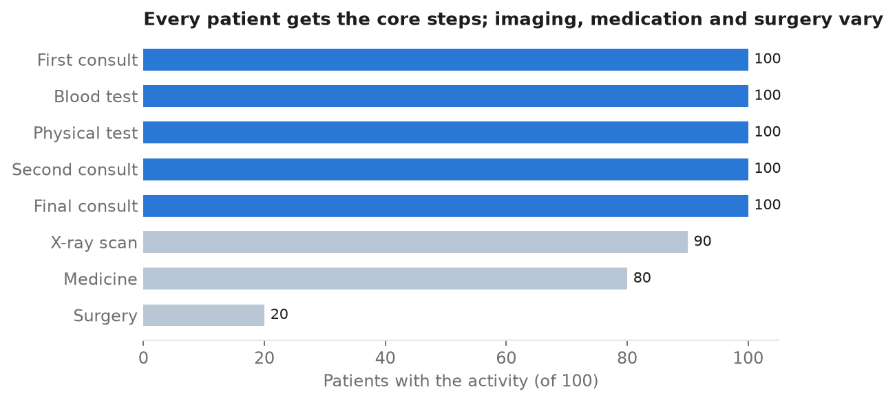
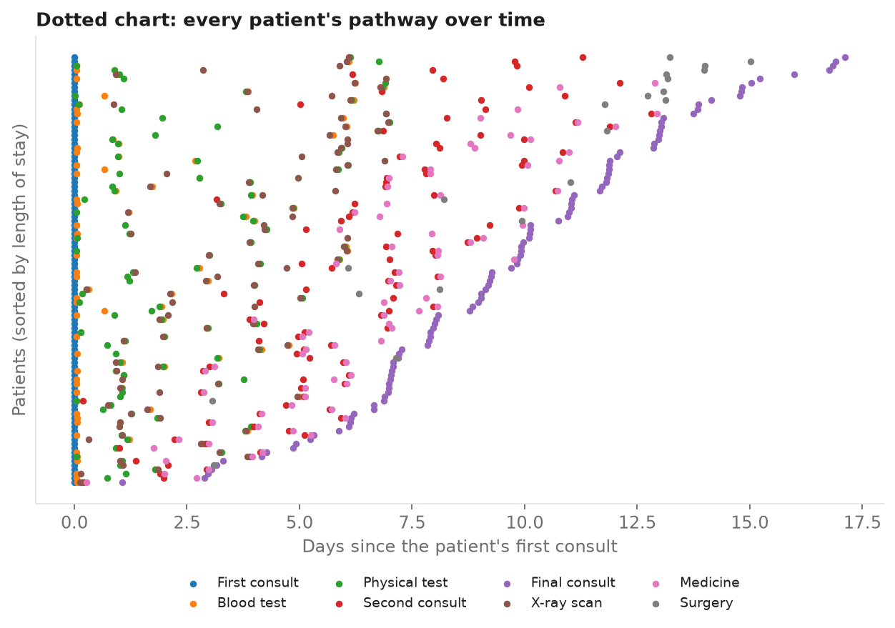
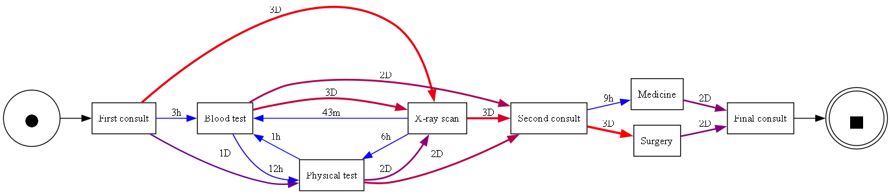
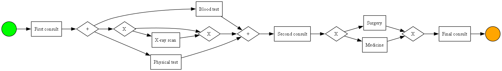

# Patient Pathways and Hospital Resources: a Process Mining Case Study

  

**Case study:** [rolandkeszi.github.io/projects/process-mining.html](https://rolandkeszi.github.io/projects/process-mining.html)

This project processes a hospital event log with process mining tools. The aim is to understand **the pathways patients take through care** and **how heavily hospital staff are loaded**, and to present the relationships between hospital events in a clear, visual way.

## Data

The data are an event log of **100 patients and 690 events**: 8 activity types and 13 resources (doctors, nurses, lab, pharmacy and surgical teams). Each event records the patient, the activity, the responsible resource and a timestamp. The log is artificial and was created for teaching, from the open [process mining in healthcare tutorial](https://gitlab.com/healthcare2/process-mining-tutorial). The notebook downloads it at run time; it is not redistributed here. Staff names in the log are replaced with pseudonyms (Doctor 1, Nurse 1, …), so no figure or table shows a personal name.

## Exploratory analysis

<p align="center"></p>

- **Every patient goes through the full pathway**, from the first consult to the final consult, and **blood tests and physical examinations are done for everyone**. Surgery, imaging and medication do not apply to every patient.
- **Blood tests and physical examinations come early** in the stay and vary little in timing.
- **Early morning and late afternoon** are the quietest hours of the day.
- **The dotted chart** shows a steady flow of cases over time, and the workload chart shows how the cases are spread across doctors, nurses and other staff.

<p align="center"></p>

## Process discovery

**Directly-follows graph (DFG).** Every pathway starts with the *first consult* (100 cases) and continues with examinations: physical test, blood test and X-ray/MRI. After the *second consult* (100 cases), patients go on to **medication (80) or surgery (20)**, and every pathway ends with the *final consult* (100).

**Time-based DFG.** The average time between steps shows where the pathway is slow and where time could be saved:

<p align="center"></p>

| Transition | Average time |
|---|---|
| First consult → physical test | 1 day |
| First consult → X-ray/MRI | 3 days |
| Physical test → blood test | 1 hour |
| Physical test → X-ray/MRI | 6 hours |
| X-ray/MRI → blood test | 43 minutes |
| Blood test → second consult | 2 days |
| Second consult → medication | 9 hours |
| Second consult → surgery | 3 days |
| Medication or surgery → final consult | 2 days |

**Process tree and BPMN.** The inductive miner turns the log into a structured model. After the first consult, the blood test, the physical test and an optional X-ray/MRI run **in parallel**. After the second consult comes an **exclusive choice** between medication and surgery.

<p align="center"></p>

**Heuristic net.** This model shows the frequency of each activity and transition and highlights the most common paths. Medication plays a much larger role than surgery.

## Comparing discovery algorithms

| Miner | Fitness | Precision | Generalization | Simplicity |
|---|---:|---:|---:|---:|
| Alpha miner | 0.990 | 0.983 | 0.882 | 0.818 |
| **Inductive miner** | **1.000** | **0.984** | 0.860 | 0.760 |
| Heuristic miner | 0.990 | 0.983 | 0.882 | 0.818 |

The **inductive miner covers the log perfectly** (fitness 1.000) with the highest precision, but its model is more complex and generalises slightly less well. The **alpha and heuristic miners** give simpler, better-generalising models with almost the same fit. Which miner is best depends on which quality dimension matters most for the project.

## Conclusions

- The typical pathway runs from the first consult, through parallel examinations, to the second consult, then to medication or surgery, and ends with the final consult.
- Core examinations are universal, while specialised care such as surgery and imaging is case-dependent. The key **decision point** comes after the second consult.
- Process mining shows **staff workload** and **where throughput time could be reduced** to speed up care. Applied to real hospital data, the same approach could help make hospital processes more efficient.

**Limitation:** the event log is artificial and was created for teaching, so the results illustrate the method rather than a real hospital.

## Run it

```bash
pip install -r requirements.txt     # also needs Graphviz installed and on PATH
jupyter notebook notebooks/patient_pathways.ipynb
```

## Repository structure

```text
├── notebooks/patient_pathways.ipynb   # full analysis, executed
├── figures/                           # charts and process maps
├── src/build_notebook.py              # generates the notebook from source
└── requirements.txt
```

## References

- van der Aalst, W. M. P. *Process Mining: Discovery, Conformance and Enhancement of Business Processes*. Springer. https://doi.org/10.1007/978-3-642-19345-3
- van Zelst, S. J., & Leemans, S. J. J. (2020). Translating workflow nets to process trees: an algorithmic approach. *Algorithms*, 13(11), 279. https://doi.org/10.3390/a13110279
